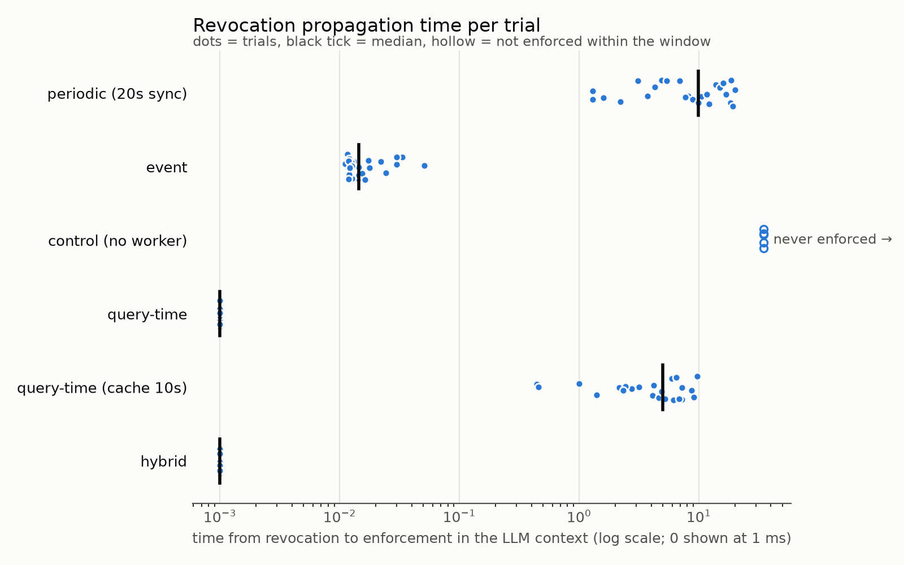
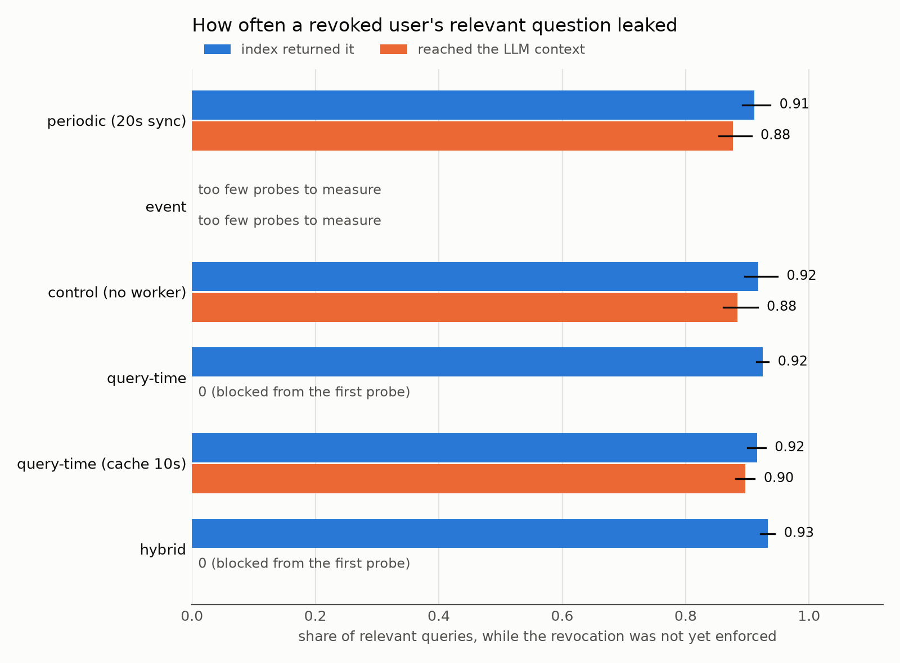

# Revocation Window in Retrieval-Augmented Generation (RAG)

Measuring access-control revocation delay and protected-content exposure in a Retrieval-Augmented Generation (RAG) pipeline.

This repository contains the source code, experiment logs, cleaned trial data, analysis scripts, tables, and figures for a controlled study of permission revocation in a RAG system.

The central distinction in this study is between:

- **Unauthorized index retrieval:** the vector database still returns a chunk from a document after the user's permission has been revoked.
- **LLM-context exposure:** that protected chunk is allowed through the context-building stage and reaches the context intended for the LLM.

A stale vector index can continue returning protected content even when a separate authorisation check prevents that content from reaching the LLM context. The experiments measure these outcomes separately.

## Contents

1. [Research objectives](#1-research-objectives)
2. [System architecture](#2-system-architecture)
3. [Enforcement configurations](#3-enforcement-configurations)
4. [Metrics and definitions](#4-metrics-and-definitions)
5. [Experimental workload and settings](#5-experimental-workload-and-settings)
6. [Results included in this repository](#6-results-included-in-this-repository)
7. [Reproducing the experiments](#7-reproducing-the-experiments)
8. [Repository structure](#8-repository-structure)
9. [Pilot results and version separation](#9-pilot-results-and-version-separation)
10. [Limitations and interpretation](#10-limitations-and-interpretation)
11. [Team](#11-team)

## 1. Research objectives

The experiments investigate:

1. How long protected content remains retrievable after a permission is revoked.
2. How periodic and event-driven index synchronisation compare.
3. Whether query-time authorisation and a hybrid authorisation gate prevent protected content from reaching the LLM context while the index remains stale.
4. How a 10-second authorisation-cache TTL affects the revocation window.
5. The trade-off between revocation behaviour and probe latency.

The repository implements a synthetic, controlled testbed. The reported measurements should not be interpreted as production-system guarantees or as measurements of real user behaviour.

## 2. System architecture

| Component | Version / configuration | Purpose |
|---|---|---|
| Python | 3.14.2 in the recorded experiment environment | Trial execution and analysis |
| PostgreSQL | 16.15 | Authoritative users, groups, documents, ACLs, and revocation state |
| Qdrant | 1.20.0 | Vector storage and similarity retrieval |
| Sentence Transformers | all-MiniLM-L6-v2 | Text embedding |
| Docker Compose | Used by the setup script | Starts PostgreSQL and Qdrant |
| GitHub Codespaces | Recorded execution environment | Experiment execution |

The Qdrant collection used by the experiment scripts is `chunks_1k`. Embeddings are normalised and Qdrant uses cosine distance. The indexing script creates payload indexes for `allowed_principals` and `doc_id`.

**Exact search.** The recorded Qdrant collection contained 4,897 vectors, but its HNSW indexed-vector count was zero (see `paper/setup_output_final.txt`). Therefore, the recorded vector searches used exact (brute-force) search rather than an approximate HNSW index. Results may differ for a large collection that uses an approximate HNSW index.

### 2.1 Synthetic dataset

`build_dataset.py` generates a synthetic organisation and document collection. The recorded setup uses:

- 1,000 users
- 2,500 documents
- 3,501 ACL rows
- 4,897 text chunks
- Random seed: 42
- Document source: synthetic text generated with Faker
- Chunk size: 300 words
- Chunk overlap: 30 words

The ACL generator assigns documents to public (about 60%), group-level (about 30%), or individual-user (about 10%) principals. The generated chunk payloads contain the document ID, chunk ID, text, allowed principals, and ACL version.

The setup script's expected database counts are 1,000 users, 2,500 documents, and 3,501 ACL rows. The recorded cleaning report (`paper/cleaning_report.csv`) shows zero rows affected by its listed duplicate, missing-value, orphan, and ACL-consistency checks.

The generated `data_1k/` and `data_1k_clean/` folders are not included in the repository; the setup script rebuilds them.

### 2.2 Permission and retrieval flow

PostgreSQL is treated as the authoritative permission store. Qdrant stores document chunks and their indexed `allowed_principals` payload.

The trial scripts select a user/document pair for which the user's access depends on a revocable direct user grant, then revoke that grant and probe the retrieval pipeline. In the periodic and cache-TTL configurations, the revocation is issued at a random point within the sync interval or cache TTL, which is why the median revocation time is about half of the interval or TTL.

The index can therefore remain stale for some period after the PostgreSQL permission changes. The different enforcement modes determine whether and when the Qdrant payload is synchronised, and whether a fresh PostgreSQL check is performed before context construction.

## 3. Enforcement configurations

The final experiment suite contains six configurations:

| Configuration | Behaviour |
|---|---|
| Periodic synchronisation (20 s) | A background synchronisation loop copies changed ACLs from PostgreSQL into Qdrant every 20 seconds. |
| Event-driven synchronisation | PostgreSQL `LISTEN/NOTIFY` signals a worker to update the corresponding Qdrant ACL payload after a permission change. |
| Control (no worker) | Runs the event trial with `--no-worker`; the event worker is disabled. This is a stale-state control, not a normal enforcement strategy. |
| Query-time authorisation | Does not use an ACL filter in the vector search. A fresh PostgreSQL authorisation check determines which retrieved chunks may reach the context. |
| Hybrid authorisation | Uses the Qdrant ACL filter as a pre-filter and then performs a PostgreSQL authorisation check before context construction. |
| Query-time authorisation (cache TTL 10 s) | Uses query-time authorisation with a 10-second cache TTL for authorisation decisions. |

In query-time and hybrid modes, the index is deliberately not updated after revocation. The PostgreSQL gate controls whether retrieved content reaches the LLM context. In the cache-TTL configuration, a cached authorisation decision can remain in use until its TTL expires.

## 4. Metrics and definitions

### 4.1 Revocation Propagation Time (RPT)

RPT is the elapsed time between permission revocation and stable enforcement:

```text
RPT = t_enforcement - t_revocation
```

The implementation calculates two versions:

- **Index RPT** (`rpt_index_s`): time until the index stops returning the protected chunk.
- **Context RPT** (`rpt_ctx_s`): time until the protected chunk stops reaching the LLM context.

Stable enforcement is defined as the first probe in the final run of at least three consecutive blocked probes that remains blocked through the end of the trial. Probes that end in an HTTP error are excluded from the analysis rather than counted as blocked, and trials whose error rate exceeds the cleaner's `--max-error-rate` limit are dropped.

RPT is measured from a clean reference search (a search for the protected document itself). The rates below (URR, CER and their variants) are measured from the noisier workload search, in which a random share of queries is about the protected document.

The analysis also reports Kaplan–Meier (KM) estimates for context RPT so that censored trials are retained in the time-to-enforcement analysis.

A displayed value of 0 ms means the context gate blocked the protected content at the first post-revocation probe / at the resolution of this probe-based measurement. It should not be interpreted as proof of literally zero physical processing time.

### 4.2 Unauthorized Retrieval Rate (URR)

URR measures how often the index returns the protected chunk after revocation:

```text
URR = post-revocation probes returning the protected chunk
      / total post-revocation index probes
```

The whole-window URR depends on the selected observation window and workload.

### 4.3 Context Exposure Rate (CER)

CER measures how often the protected chunk reaches the LLM context after revocation:

```text
CER = post-revocation probes with protected content in context
      / total post-revocation context probes
```

URR and CER describe different pipeline stages. A protected chunk may be returned by Qdrant but rejected by the PostgreSQL authorisation gate before context construction.

### 4.4 Interval and relevant-query rates

The cleaner calculates rates over the interval before the relevant enforcement point:

- `urr_interval`: index-return rate before index enforcement.
- `cer_interval`: context-exposure rate before context enforcement.
- `urr_rel_interval`: index-return rate for probes marked relevant to the protected document.
- `cer_rel_interval`: context-exposure rate for relevant probes.

The summary file uses `urr_rel` and `cer_rel` for the pooled relevant-query rates.

The relevant-query interval rates are calculated as:

```text
URR_rel_interval =
  relevant index probes returning the protected chunk
  / relevant index probes before index enforcement

CER_rel_interval =
  relevant context probes containing protected content
  / relevant context probes before context enforcement
```

These rates answer a conditional question: when a revoked user asks about the protected document, how often does the index return it or does it reach the LLM context? They are not the same as the whole-window URR and CER defined above.

The interval endpoints differ:

- The URR interval ends when the index stops returning the chunk. In query-time and hybrid modes the index is deliberately left stale, so this interval covers the observation window.
- The CER interval ends when the chunk stops reaching the context.

A `NaN` value means the corresponding denominator is zero (no probe fell inside the interval). It is not a measured zero rate. In query-time and hybrid modes, `NaN` for CER is the expected result because the gate blocks from the first probe.

### 4.5 Additional measurements

| Field | Meaning |
|---|---|
| `leaked_probes` | Number of probes returning the protected chunk inside the URR interval; summary reports a per-trial mean. It depends on the probe rate, so compare only between runs with the same settings. |
| `ctx_chunks` | Protected-document chunks reaching context per context probe over the context interval. |
| `ctx_chars` | Protected-text characters reaching context per context probe over the context interval. |
| `lat_mean` | Mean probe latency. |
| `lat_p95` | Per-trial p95 probe latency; the summary reports the mean of trial-level p95 values. |
| `n_attempts` | Number of valid post-revocation attempts in the trial. |
| `error_rate` | Share of attempts with an HTTP error. |

One probe performs two searches, plus the PostgreSQL gate queries in gate modes.

### 4.6 Censored trials

A trial is censored when stable blocking is not observed within the observation window.

Censored trials are retained, not deleted. The KM analysis includes them. If every trial in a configuration is censored, the report states that revocation was not enforced within the observation window; it does not treat the end of the window as the actual enforcement time.

### 4.7 Expected exposures

The cleaner estimates expected context exposures using an assumed query rate and an assumed share of queries about the protected document:

```text
expected exposures
  = (qpm / 60)
    × share_relevant
    × mean context RPT
    × relevant-query context-exposure rate
```

Defaults in `clean_logs.py`:

- `--qpm 1`: assumed one query per minute.
- `--share-relevant 0.1`: assumed 10% of queries concern the protected document.

These are assumptions, not observed user behaviour.

The `exp_basis` field records how the context-exposure rate was obtained:

- **measured:** enough relevant probes (at least 30) were observed in the interval.
- **measured (blocked from the first probe):** no probe fell before enforcement; the context gate blocked from the first post-revocation probe.
- **estimated: window below probe resolution:** too few relevant probes were available for a direct estimate, so the cleaner used a stale-state context-exposure rate pooled from periodic/no-worker reference data.
- **unbounded:** revocation never enforced; all trials were censored.
- **upper bound:** used only if no stale-state rate is available (the rate is then taken as 1). This does not occur in the final table.

Always report the `exp_basis` with expected-exposure values. The expected-exposure estimate is a model-based illustration under the stated assumptions, not a direct count of real user disclosures.

## 5. Experimental workload and settings

The final run script (`final_runs.sh`) uses:

| Parameter | Setting |
|---|---|
| Observation window after revocation | 35 seconds |
| Periodic synchronisation interval | 20 seconds |
| Minimum relevance parameter (`--min-alpha`) | 0.2 |
| Probability a workload query is relevant (`--p-relevant`) | 0.5 |
| Qdrant fetch size (`FETCH`) | 20 chunks |
| Context size (`CTX_K`) | 5 chunks |
| Periodic probe target gap | 100 ms |
| Event/gate probe target gap | 10 ms |

Each workload probe is a random draw:

- With probability `--p-relevant`, the query is about the protected document and its relevance is drawn between `--min-alpha` and 1.
- Otherwise, the query is unrelated to the protected document.

The periodic probe loop targets approximately 10 probes per second; event and gate loops target up to approximately 100 probes per second (slightly fewer when probe latency exceeds the 10 ms gap, as in gate modes at about 12.5 ms). These probe rates are measurement settings, not claims about real user request rates.

Compare whole-window URR/CER only across runs with the same observation window and workload settings.

## 6. Results included in this repository

The table below reproduces the values in the checked-in `report_tables/final_table.csv`. It describes the experiment outputs included in this repository snapshot, after cleaning and warm-up exclusion.

| Configuration | Trials | Not enforced | Context RPT median (KM) | Context RPT p95 (KM) | Relevant-query index exposure before index enforcement | Relevant-query context exposure before context enforcement |
|---|---:|---:|---:|---:|---:|---:|
| Periodic (20 s sync) | 27 | 0 | 9.92 s | 19.13 s | 0.912 [0.890, 0.937] | 0.877 [0.855, 0.904] |
| Event-driven | 27 | 0 | 14 ms | 51 ms | 0.462 [0.200, 0.733] | Too few probes to measure (13) |
| Control (no worker) | 5 | 5 | Not reached | Not reached | 0.917 [0.896, 0.947] | 0.884 [0.861, 0.916] |
| Query-time | 27 | 0 | 0 ms* | 0 ms* | 0.925 [0.914, 0.934] | Blocked from the first probe |
| Query-time (cache 10 s) | 27 | 0 | 4.98 s | 9.04 s | 0.916 [0.901, 0.929] | 0.897 [0.881, 0.912] |
| Hybrid | 27 | 0 | 0 ms* | 0 ms* | 0.933 [0.922, 0.944] | Blocked from the first probe |

\*For query-time and hybrid, 0 ms is the probe-resolution result: the context gate blocked protected content at the first post-revocation probe. The index continued to return the protected chunk because these configurations intentionally leave the index stale.

### 6.1 Reading the results carefully

- **Periodic synchronisation:** the checked-in results show a 9.92-second KM median context RPT. Relevant-query context exposure during the revocation interval is 0.877.
- **Event-driven synchronisation:** the KM median context RPT is 14 ms. However, only 13 relevant context probes were observed across the retained event trials, below the cleaner's 30-probe threshold. The table therefore does not present a direct context-exposure rate for this mode. Its expected-exposure estimate uses the stale-state reference rate and is labelled as estimated in the output.
- **No-worker control:** all five retained control trials were censored; stable revocation enforcement was not observed within the 35-second observation window.
- **Query-time and hybrid:** both blocked protected content from the first post-revocation probe in the context path, while the index continued to return protected content. This is why index exposure is high while context exposure is shown as blocked from the first probe.
- **Query-time with a 10-second cache TTL:** the checked-in results show a 4.98-second KM median context RPT and 0.897 relevant-query context exposure in the interval.

The relevant-query rates are pooled over probes, not calculated as an unweighted average of per-trial percentages. The confidence intervals in `final_table.csv` are generated by resampling whole trials.

### 6.2 Expected-exposure estimates in the checked-in table

The checked-in table uses the cleaner defaults of one assumed query per minute and 10% relevant queries. Its expected-exposure values are:

| Configuration | Expected exposures per revocation | Basis |
|---|---:|---|
| Periodic (20 s sync) | 0.015 | Measured |
| Event-driven | 2.8e-05 | Estimated; interval below probe resolution, stale-state rate 0.884 |
| Control (no worker) | Unbounded | Revocation not enforced within the window |
| Query-time | 0 | Blocked from the first probe |
| Query-time (cache 10 s) | 0.0073 | Measured |
| Hybrid | 0 | Blocked from the first probe |

These estimates depend on the assumed query rate and relevance share. `report_tables/sensitivity.csv` contains sensitivity values for 0.2, 1, and 5 queries per minute and 5%, 10%, and 30% relevant-query shares.

### 6.3 Figures

Revocation propagation time per trial (dots are trials, the black tick is the median, hollow dots are trials not enforced within the window; log scale):



Relevant-query exposure before enforcement (share of relevant queries that the index returned, and that reached the LLM context):



The figures are generated by `make_tables.py` from the cleaned trial-level data.

## 7. Reproducing the experiments

### 7.1 Requirements

- Git
- Docker with Docker Compose
- Python (the recorded experiment environment used Python 3.14.2)
- Sufficient memory and disk space for model download, embedding, and vector indexing

The recorded environment used PostgreSQL 16.15, Qdrant 1.20.0, 2 CPU cores and 7.8 GiB RAM.

### 7.2 Clone the repository

```bash
git clone https://github.com/prgyya/rag-revocation-window.git
cd rag-revocation-window
```

### 7.3 Set up the testbed

```bash
bash setup_testbed.sh
```

The setup script:

1. Installs the pinned dependencies from `requirements.lock` when it exists; otherwise it uses `requirements.txt`.
2. Starts PostgreSQL and Qdrant with Docker Compose.
3. Generates the synthetic dataset if `data_1k/schema.sql` does not already exist, then cleans it.
4. Recreates and loads the PostgreSQL schema and data.
5. Embeds the chunks and loads them into the `chunks_1k` Qdrant collection (about 8 minutes in the recorded run).
6. Prints the user/document/ACL counts.
7. Runs `verify_testbed.py` to check consistency between PostgreSQL ACLs and Qdrant payloads.

**Important:** `setup_testbed.sh` drops and recreates the PostgreSQL `public` schema. The embedding script also deletes and recreates the target Qdrant collection. Run this only in the dedicated research testbed; do not point it at databases or collections containing data you need to preserve.

Expected setup counts: users = 1000, docs = 2500, acl_rows = 3501.

### 7.4 Run the final experiment suite

```bash
bash final_runs.sh
```

The script executes the six configurations sequentially. Each command uses the shared settings `--window 35 --min-alpha 0.2 --p-relevant 0.5`. The equivalent individual commands are shown below for reference.

1. Periodic synchronisation

```bash
python trial_periodic.py --interval 20 --trials 30 --window 35 --min-alpha 0.2 --p-relevant 0.5 --out results_periodic_v3
```

2. Event-driven synchronisation

```bash
python trial_event.py --trials 30 --window 35 --min-alpha 0.2 --p-relevant 0.5 --out results_event_v3
```

3. No-worker control

```bash
python trial_event.py --trials 5 --no-worker --window 35 --min-alpha 0.2 --p-relevant 0.5 --out results_event_v3
```

4. Query-time authorisation

```bash
python trial_gate.py --mode query-time --trials 30 --window 35 --min-alpha 0.2 --p-relevant 0.5 --out results_gate_v3
```

5. Hybrid authorisation

```bash
python trial_gate.py --mode hybrid --trials 30 --window 35 --min-alpha 0.2 --p-relevant 0.5 --out results_gate_v3
```

6. Query-time authorisation with a 10-second cache

```bash
python trial_gate.py --mode query-time --cache-ttl 10 --trials 30 --window 35 --min-alpha 0.2 --p-relevant 0.5 --out results_gate_v3
```

`final_runs.sh` writes raw trial and attempt logs to the three `results_*_v3/` folders and saves console logs under `paper/`.

The trials are run sequentially because they change permissions in the same PostgreSQL database and Qdrant collection. Do not run multiple trial processes concurrently against the same testbed. Separate Codespaces have separate databases and can run independently.

### 7.5 Clean the logs and generate tables

```bash
bash analyse.sh
```

`analyse.sh`:

1. Runs `clean_logs.py` on the periodic, event, and gate v3 folders.
2. Writes cleaned trial data, exclusions, and summaries to the matching `*_v3_clean/` folders.
3. Runs `make_tables.py` to generate the combined final table, sensitivity table, and figures in `report_tables/`.

The analysis uses the cleaner's warm-up exclusion of three trials per mode/configuration (`--warmup 3`). The no-worker control has five trials and is exempt from warm-up exclusion.

The checked-in cleaned results contain:

- Periodic: 27 retained trials.
- Event-driven: 27 retained trials.
- No-worker control: 5 retained trials.
- Query-time: 27 retained trials.
- Hybrid: 27 retained trials.
- Query-time cache TTL 10 s: 27 retained trials.

`make_tables.py` uses 2,000 bootstrap resamples by default. Confidence intervals resample whole trials rather than individual probes, because probes within a trial are correlated.

### 7.6 Optional validation workflow

```bash
bash test_v4.sh
```

This separate validation script runs a periodic test with:

- 10-second synchronisation interval
- 25-second observation window
- 10 trials
- `--min-alpha 0.2`
- `--p-relevant 0.5`

It then runs `check_unrelated.py` and cleans the validation results with zero warm-up exclusions.

The console logs of the recorded validation run are checked in under `paper/` (`check_unrelated.txt`, `test_v4_periodic.txt`, `test_v4_summary.txt`); the raw and cleaned `results_test_v4*` folders are not checked in (they are gitignored). The recorded output reports 1.4% of unrelated probes returning the revoked document (210 unrelated probes), and 90.2% context exposure for relevant probes (224 relevant probes). This is a separate validation run, not part of the six-configuration final comparison table.

### 7.7 Optional environment capture

After setting up the testbed, the environment can be recorded with:

```bash
bash save_env.sh
```

This writes environment details to `paper/environment.txt`, captures `pip freeze` in `requirements.lock`, and copies the data-cleaning report into `paper/`.

## 8. Repository structure

```text
rag-revocation-window/
├── README.md
├── .gitignore
├── docker-compose.yml
├── requirements.txt
├── requirements.lock
│
├── build_dataset.py
├── clean_data.py
├── embed_to_qdrant.py
├── search_as.py
├── verify_testbed.py
│
├── trial_periodic.py
├── trial_event.py
├── trial_gate.py
├── clean_logs.py
├── make_tables.py
├── rank_check.py
├── check_unrelated.py
│
├── setup_testbed.sh
├── final_runs.sh
├── analyse.sh
├── test_v4.sh
├── save_env.sh
│
├── paper/
│   ├── environment.txt
│   ├── cleaning_report.csv
│   ├── setup_output.txt
│   ├── setup_output_final.txt
│   ├── run_periodic.txt
│   ├── run_event.txt
│   ├── run_noworker.txt
│   ├── run_querytime.txt
│   ├── run_hybrid.txt
│   ├── run_cache.txt
│   ├── summary_periodic.txt
│   ├── summary_event.txt
│   ├── summary_gate.txt
│   ├── final_table.txt
│   ├── test_v4_periodic.txt
│   ├── test_v4_summary.txt
│   └── check_unrelated.txt
│
├── results_periodic_v3/
├── results_event_v3/
├── results_gate_v3/
│
├── results_periodic_v3_clean/
├── results_event_v3_clean/
├── results_gate_v3_clean/
│
├── report_tables/
│   ├── final_table.csv
│   ├── sensitivity.csv
│   ├── rpt_by_mode.png
│   └── exposure_rates.png
│
└── pilot/
    ├── results_periodic/
    ├── results_event/
    ├── results_gate/
    └── corresponding *_clean and *_clean_all folders
```

The generated dataset folders (`data_1k/` and `data_1k_clean/`) are created by the setup script and are not checked into this repository snapshot. The `results_test_v4*` folders created by `test_v4.sh` are gitignored.

## 9. Pilot results and version separation

The `pilot/` directory contains outputs from an earlier version of the experiment scripts. Those results use an earlier metric implementation, including a CER calculation that was not equivalent to the current context-exposure measurement in periodic and event modes.

Do not combine pilot results with the v3 results.

The current final comparison uses the v3 raw folders, the v3 cleaned folders, and the generated files in `report_tables/`.

The `test_v4.sh` workflow is a separate validation run. It should also remain distinct from the six-configuration final comparison unless a paper explicitly describes and justifies a combined analysis.

## 10. Limitations and interpretation

- **Synthetic workload:** The users, documents, ACLs, and workload queries are generated for a controlled testbed. They do not represent all production RAG traffic.
- **Exact (brute-force) search:** The Qdrant collection was searched without a built HNSW index, so retrieval was exact. Approximate-index behaviour was not tested.
- **Probe frequency:** Probe intervals are measurement settings, not observed real-world query rates.
- **Expected exposure assumptions:** Expected exposure counts depend on assumed query rate and relevant-query share.
- **Probe resolution:** Very short event-driven intervals can contain too few relevant probes to estimate a conditional exposure rate directly. The analysis labels such estimates and reports their basis.
- **Censoring:** A censored trial means stable enforcement was not observed within the selected window. It does not establish that enforcement would never happen.
- **Architecture scope:** Results apply to the specific PostgreSQL/Qdrant testbed and implementations in this repository. They should not be generalised to every RAG system without further testing.
- **Latency scope:** Probe latency includes the operations performed by the trial code. It is not a complete end-to-end user-perceived LLM response latency measurement.

## 11. Team

- Pragya Rai
- Chetna Umakant Shete
- Omkar Sanjay Jadhav
- Swaraj Santosh Godalkar
